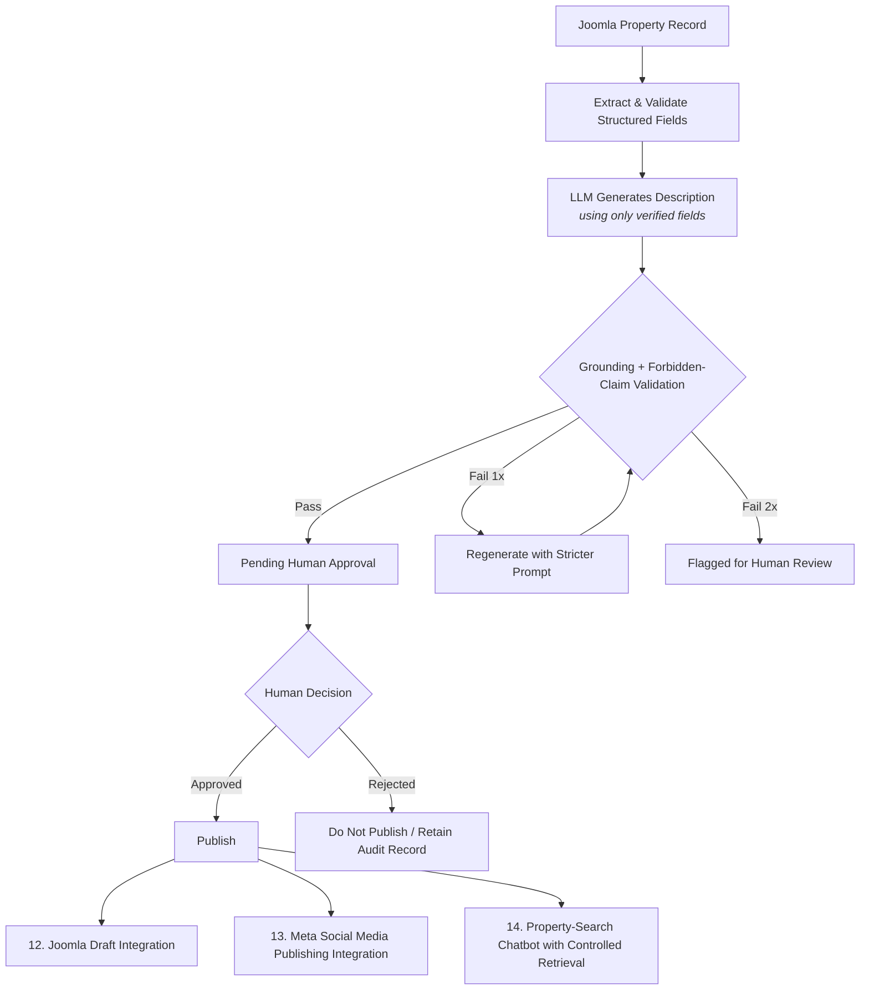

# AQARI AI

AQARI AI is an AWS-focused, serverless AI assistant for controlled real-estate listing generation.

It is designed for a Bahrain real-estate workflow in which an authorized agent enters verified property facts and uploads approved property photos. The system generates editable listing drafts, SEO content, and social-media drafts while keeping a human responsible for factual verification and external publication.


## Project status

**Current phase:** Local repository baseline and domain validation.

**MVP target:**
- Create a property draft from verified structured data
- Store original photos privately in Amazon S3
- Generate English listing content with Amazon Bedrock
- Produce a title, description, summary, SEO metadata, Facebook draft, Instagram caption, hashtags, and suggested image order
- Require human review before Joomla or social-media publication
- Export an approved listing package for manual Joomla publishing


## Planned AWS architecture

```text

Admin dashboard
      |
      v
Amazon API Gateway
      |
      v
AWS Lambda (Python)
      |
      +--> Amazon DynamoDB: property drafts and audit records
      +--> Amazon S3: private original property photos
      +--> Amazon Bedrock: controlled listing text generation
      +--> Amazon CloudWatch: logs, metrics, and alarms
      +--> Amazon Cognito: administrator authentication
```

## Security principles

- No real property data, images, customer details, database exports, passwords, API keys, or tokens are committed to this repository.
- Original property images remain private.
- AI receives only human-verified property facts and approved photo references.
- AI output is a draft, not a source of truth.
- External Joomla, Facebook, or Instagram publication requires human approval.
- AWS credentials are supplied through AWS IAM roles and local AWS CLI configuration, never committed to Git.

## Local setup

### Prerequisites

- Python 3.12+
- Git
- AWS CLI configured locally
- Terraform, for the infrastructure phase
- VS Code with the WSL extension when using Windows + WSL

### Install dependencies

```bash
python3 -m venv .venv
source .venv/bin/activate
make install
```

### Validate the baseline

```bash
make validate
```

## Repository structure

```text
backend/                 Python application source and tests
docs/                    Architecture, security, operations, and deployment documentation
infrastructure/          AWS Console checklist and Terraform infrastructure
sample-data/             Safe schema-only sample data
.github/workflows/       GitHub Actions CI workflows
```

## Data handling

This public repository uses safe example data only. Do not add:
- Joomla database exports
- customer names, phones, emails, or exact addresses
- production property images
- AWS access keys
- Meta access tokens
- Joomla credentials
- Terraform state files

See [docs/data-privacy.md](docs/data-privacy.md) for the planned data-handling policy.

## Roadmap

1. Local property schema and validation
2. AWS cost controls and Bedrock model selection
3. S3, DynamoDB, Lambda, and API Gateway MVP
4. Amazon Cognito administrator authentication
5. Bedrock listing-generation workflow
6. Private admin dashboard
7. Terraform implementation
8. GitHub Actions CI/CD
9. Rekognition photo analysis
10. Step Functions approval workflow


# AQARI AI Flow: AI Layer

This section outlines the automated AI processing pipeline for the **AQARI AI Flow**, which handles property ingestion, multi-stage LLM validation, and automated publishing integration.

## Workflow Diagram



## Architecture Breakdown

### 1. Ingestion & Core Pipeline
*   **Data Ingestion:** Starts directly from the **Joomla property record**.
*   **Field Extraction:** Extracts and validates structured fields to establish a factual baseline.
*   **Generation:** The LLM generates property descriptions strictly constrained to the verified fields.

### 2. Multi-Stage Guardrails & Validation
*   **Grounding Check:** Every generated text undergoes automated strict verification against source data.
*   **Forbidden-Claim Validation:** Filters out non-compliant or illegal marketing claims.
*   **Error Handling Loop:** 
    *   *First Failure:* Automatically triggers a re-generation using an escalated, stricter prompt.
    *   *Second Failure:* Escalates immediately out of the automated loop and flags the record for manual review.

### 3. Publishing & Downstream Integrations
Once human approval is secured, the data triggers three parallel downstream actions:
*   ** Joomla Draft Integration:** Updates and optimizes the record directly in the CMS backend.
*   ** Meta Social Media Publishing Integration:** Formats and queues the listing for social channels.
*   ** Property-Search Chatbot:** Synchronizes the approved record with the controlled retrieval vector database for client-facing queries.

LLMOps + governance + AIOps design - Complete AQARI AI workflow
“AQARI AI uses a controlled draft workflow. The LLM generates a description only from verified property fields. Validation checks grounding and forbidden claims. A passing draft goes to human approval; a failing draft is flagged for review after a controlled retry. Only an approved draft can be published, while rejected drafts remain blocked and auditable.”
